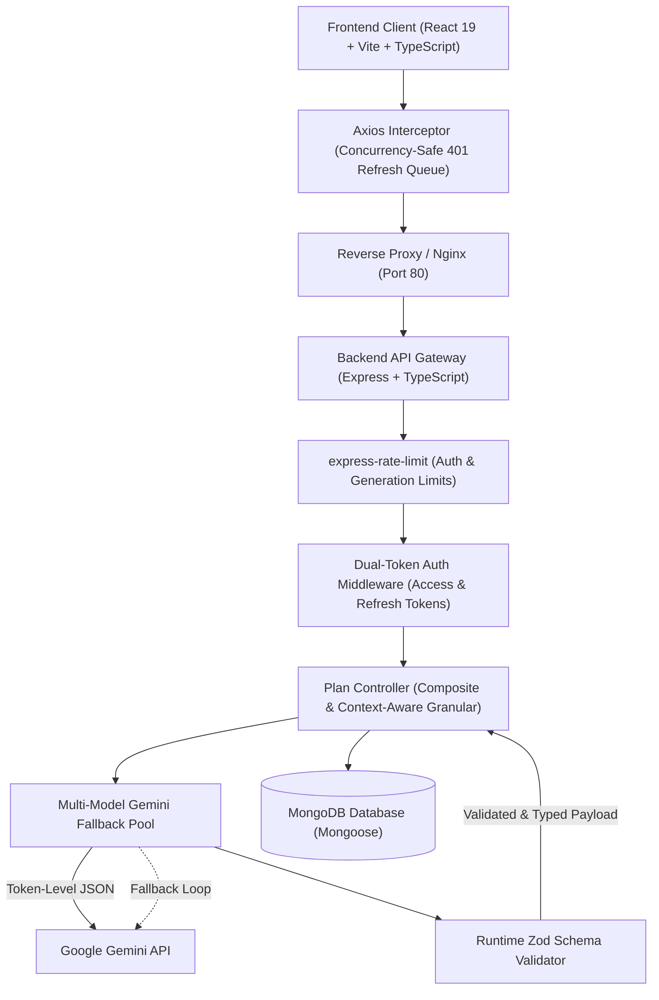

# Planify 🚀
### AI-Powered Technical Architecture & Agile Product Specification Engine

[](https://www.typescriptlang.org/)
[](https://react.dev/)
[](https://nodejs.org/)
[](https://expressjs.com/)
[](https://www.mongodb.com/)
[](https://ai.google.dev/)
[](https://www.docker.com/)

> **Transform raw, unstructured product ideas into cohesive, production-grade technical engineering specifications in under 8 seconds.**

---

## 📌 Executive Overview

Drafting technical specifications, Agile user stories, relational/document database schemas, RESTful API contracts, and engineering sprint roadmaps manually takes product teams and tech leads **6 to 10 hours** per feature.

**Planify** closes the product-to-engineering gap by synthesizing an end-to-end, interconnected technical blueprint from a single natural language product prompt. Built on an **Aggregated Composite Architecture**, Planify avoids chatty LLM overhead, prevents cross-section context drift, validates all LLM outputs at runtime with **Zod**, and secures user sessions with **Dual-Token Rotating Authentication**.

---

## 🏛️ System Architecture



---

## ✨ Key Engineering Highlights & Production Features

### 1. 🛡️ Dual-Token Rotating Authentication (Zero-Trust Security)
- **Short-Lived Access Token (`15m`):** Stored in an `HttpOnly`, `SameSite` cookie to safeguard against XSS token theft.
- **Rotating Refresh Token (`7d`):** Persisted as a **SHA-256 hash** in MongoDB (`refreshTokenHash` with `select: false` so it never leaks in queries).
- **Automatic Token Rotation & Reuse Detection:** Issuing a refresh immediately invalidates the previous refresh token. If a revoked or reused refresh token is presented, all user sessions are immediately invalidated (anti-hijacking defense).
- **Concurrency-Safe Axios 401 Interceptor:** When multiple parallel requests fail with 401, a shared `refreshPromise` queues all outgoing requests until the new access token is established, preventing stampedes and race conditions.

### 2. 🔍 Runtime Zod LLM Validation & Schema Guardrails
- LLMs are non-deterministic; database writes cannot afford to be.
- All JSON outputs received from Google Gemini are strictly parsed against **Zod runtime schemas** (`requirementsSchema`, `dbSchemaValidator`, `apiSchemaValidator`, `sprintPlanSchema`) before touching MongoDB.
- Rejects schema anomalies, validates array structures, and guarantees strict type adherence across all persistence layers.

### 3. 🧠 Context-Aware Granular Section Regeneration (Zero Entity Drift)
- Independent tab mutations (`/generate-schema`, `/generate-apis`, `/generate-sprint-plan`) are **context-aware**:
  - Regenerating the **Database Schema** injects the plan's existing **Functional Requirements**.
  - Regenerating **REST APIs** injects the existing **Database Tables** so endpoints mirror real data models.
  - Regenerating **Sprint Plans** injects both requirements and API routes to produce realistic milestone estimates.
- Guarantees seamless cross-section coherence without regenerating the entire document from scratch.

### 4. ⚡ Multi-Model Gemini Failover & Rate-Limiting Protection
- **Failover Pool:** Primary `gemini-2.0-flash-lite` → Secondary `gemini-2.0-flash` → Fallback `gemini-1.5-flash`.
- Automatically catches HTTP 429 (rate limits) or HTTP 503 (service spikes) and retries on alternate model candidates without failing user-facing requests.
- **DDoS & Abuse Defense:** Backed by `express-rate-limit` with specialized tiers:
  - `authLimiter`: 10 requests / 15 minutes per IP on registration, login, and token refresh.
  - `generationLimiter`: 5 generative requests / 10 minutes per IP on all LLM endpoints.

### 5. 📄 Client-Side Specification Export (.md & .json)
- Users can download the complete technical blueprint in one click from the Dashboard:
  - **JSON (`.json`):** Raw, structured data representation for CI/CD pipelines or tooling imports.
  - **Markdown (`.md`):** Formatted documentation ready for GitHub repos, Notion workspaces, or Jira epics.

### 6. 🐳 Production Multi-Stage Containerization & Cloud-Ready
- **Backend Dockerfile:** Multi-stage `node:20-alpine` build compiling TypeScript and stripping devDependencies in the runner image.
- **Frontend Dockerfile:** Multi-stage build pairing `node:20-alpine` with an optimized `nginx:alpine` runtime serving React Router SPA with client-side fallback (`try_files $uri $uri/ /index.html;`).
- **One-Command Stack:** Spin up the entire production environment locally with `docker compose up --build`.
- **Cloud Configurations:** Zero-downtime health check (`/api/health`), Vercel SPA routing (`vercel.json`), and Render deployment blueprint (`render.yaml`).

---

## 🛠️ Technology Stack Matrix

| Domain | Technologies | Purpose |
|---|---|---|
| **Frontend Framework** | React 19, TypeScript, Vite 8 | Ultra-fast client-side SPA rendering, strict compile safety |
| **Styling & Motion** | Tailwind CSS v4, Framer Motion, Lenis Scroll | Modern dark-mode UI, responsive layouts, physics-based scroll |
| **State & Data Fetching** | Zustand, TanStack React Query v5 | Reactive auth state, query caching, optimistic UI updates |
| **Backend Gateway** | Node.js (v20+), Express, TypeScript | High-concurrency RESTful API service |
| **Database & ODM** | MongoDB Atlas, Mongoose 8 | Document storage with strongly typed sub-schemas |
| **Artificial Intelligence** | `@google/generative-ai`, Gemini 2.0 | Structured technical blueprint generation via JSON Mode |
| **Validation & Security** | Zod, bcryptjs, jsonwebtoken, crypto (SHA-256) | Runtime schema validation, salted password hashing, dual cookies |
| **DevOps & Cloud** | Docker, Nginx, Render, Vercel | Multi-stage container builds, automated cloud deployments |

---

## 🚀 Getting Started

### Option A: Run with Docker Compose (Recommended)

Make sure you have Docker and Docker Compose installed.

1. **Clone the repository:**
   ```bash
   git clone https://github.com/your-username/ai-product-manager.git
   cd ai-product-manager
   ```

2. **Set your Gemini API key in an environment variable:**
   ```bash
   # Linux/macOS
   export GEMINI_API_KEY="your-google-gemini-api-key"

   # Windows PowerShell
   $env:GEMINI_API_KEY="your-google-gemini-api-key"
   ```

3. **Launch the entire stack:**
   ```bash
   docker compose up --build
   ```

4. **Access the applications:**
   - Frontend: [http://localhost:5173](http://localhost:5173)
   - Backend API: [http://localhost:5000](http://localhost:5000)
   - API Health Check: [http://localhost:5000/api/health](http://localhost:5000/api/health)
   - MongoDB: `localhost:27017`

---

### Option B: Run Locally with Node.js

#### Prerequisites
- **Node.js** v20.x or higher
- **MongoDB** running locally (`mongodb://127.0.0.1:27017`) or a free [MongoDB Atlas](https://www.mongodb.com/atlas) cluster
- **Google Gemini API Key** from [Google AI Studio](https://aistudio.google.com/)

#### 1. Backend Setup
```bash
cd backend
npm install

# Copy example environment configuration
cp .env.example .env
```

Configure `backend/.env`:
```env
PORT=5000
NODE_ENV=development
MONGO_URI=mongodb://127.0.0.1:27017/planify
JWT_SECRET=super_secret_jwt_key_at_least_16_chars_long
JWT_REFRESH_SECRET=super_secret_jwt_refresh_key_at_least_16_chars_long
GEMINI_API_KEY=your_gemini_api_key_here
GEMINI_MODEL=gemini-2.0-flash-lite
FRONTEND_URL=http://localhost:5173
```

Start backend development server:
```bash
npm run dev
```

#### 2. Frontend Setup
```bash
cd ../frontend
npm install
npm run dev
```

Open [http://localhost:5173](http://localhost:5173) in your browser.

---

## 📡 Complete API Reference

Base URL: `http://localhost:5000/api`

### Health & Monitoring
| Method | Endpoint | Description | Public |
|---|---|---|---|
| `GET` | `/health` | Zero-downtime uptime and health check for cloud hosts | Yes |
| `GET` | `/` | Root API ping | Yes |

### Authentication Routes (Rate-Limited: 10 req / 15 min)
| Method | Endpoint | Description | Cookies / Body |
|---|---|---|---|
| `POST` | `/auth/register` | Register new user, issue dual auth cookies | Body: `{ name, email, password }` |
| `POST` | `/auth/login` | Login user, issue dual auth cookies | Body: `{ email, password }` |
| `POST` | `/auth/refresh` | Rotate refresh token, issue new access token | Cookie: `refreshToken` |
| `GET` | `/auth/me` | Fetch authenticated user profile | Cookie: `accessToken` |
| `POST` | `/auth/logout` | Revoke active refresh token, clear cookies | Cookie: `refreshToken` |

### Plan Generation & Management (Rate-Limited: 5 req / 10 min)
| Method | Endpoint | Description | Request Body |
|---|---|---|---|
| `POST` | `/generate-full-plan` | **Atomic composite generation** of all selected sections | `{ idea: string, selected?: string[], planId?: string }` |
| `POST` | `/generate-requirements` | Granular requirements generation / update | `{ idea: string, planId?: string }` |
| `POST` | `/generate-schema` | Context-aware DB schema generation / update | `{ idea: string, planId?: string }` |
| `POST` | `/generate-apis` | Context-aware API blueprint generation / update | `{ idea: string, planId?: string }` |
| `POST` | `/generate-sprint-plan` | Context-aware sprint plan generation / update | `{ idea: string, planId?: string }` |
| `GET` | `/plans` | Retrieve all saved plans for the authenticated user | *None* |
| `GET` | `/plans/:id` | Retrieve specific plan by ID (tenant-isolated) | *None* |

---

## 📦 Production Deployment Guide

### Deploying the Backend on Render
1. Push your repository to GitHub.
2. In the Render Dashboard, create a **New Web Service** connected to your repository (or use Blueprint with `render.yaml`).
3. Set the following environment variables:
   - `NODE_ENV`: `production`
   - `PORT`: `5000`
   - `MONGO_URI`: `mongodb+srv://<username>:<password>@cluster.mongodb.net/planify?retryWrites=true&w=majority`
   - `JWT_SECRET`: High-entropy 32+ character random string
   - `JWT_REFRESH_SECRET`: High-entropy 32+ character random string
   - `GEMINI_API_KEY`: Your Google AI Studio API key
   - `GEMINI_MODEL`: `gemini-2.0-flash-lite`
   - `FRONTEND_URL`: Your Vercel frontend URL (e.g. `https://planify-app.vercel.app`)
4. Health check endpoint: `/api/health`.

### Deploying the Frontend on Vercel
1. Import your GitHub repository into Vercel.
2. Set Root Directory to `frontend`.
3. Framework Preset: **Vite**.
4. Set Environment Variable:
   - `VITE_API_URL`: Your Render backend service URL + `/api` (e.g. `https://planify-backend.onrender.com/api`).
5. Vercel automatically honors `frontend/vercel.json` for React Router SPA rewrites.

---

## 🔒 Security Standards

1. **HttpOnly & SameSite Cookie Architecture:** Tokens are completely inaccessible to client JavaScript (`document.cookie`), neutralizing cross-site scripting (XSS) extraction attacks.
2. **Reverse Proxy Trust:** Configured `app.set('trust proxy', 1)` to ensure secure cookies and real client IPs resolve accurately behind cloud load balancers.
3. **Strict IDOR Ownership Checks:** Every mutation and query validates `plan.userId.toString() === req.user._id.toString()`.
4. **Environment Eager Validation:** Zod validates required environment variables at process startup, halting execution with informative error messages before corrupt states can occur.

---

## 📄 License
MIT License. Created by [Vansh Jaiswal](https://github.com/Vanshjaiswal-Dev).
